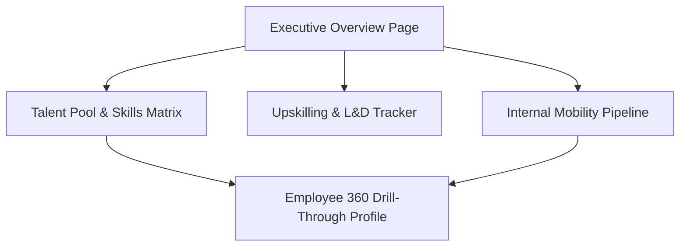

# Day 7 Deliverable: Dashboard Navigation Flow

## Navigation Hierarchy
- **Page 1: Executive Overview**: High-level KPI indicators and organization-wide summary.
- **Page 2: Talent Pool & Skills Matrix**: Deep-dive into technical proficiencies and departmental skill gaps.
- **Page 3: Upskilling & L&D Tracker**: Training completion velocity and course effectiveness.
- **Page 4: Internal Mobility Pipeline**: Application funnel, candidate shortlists, and readiness prediction scores.

## User Flow Diagram

